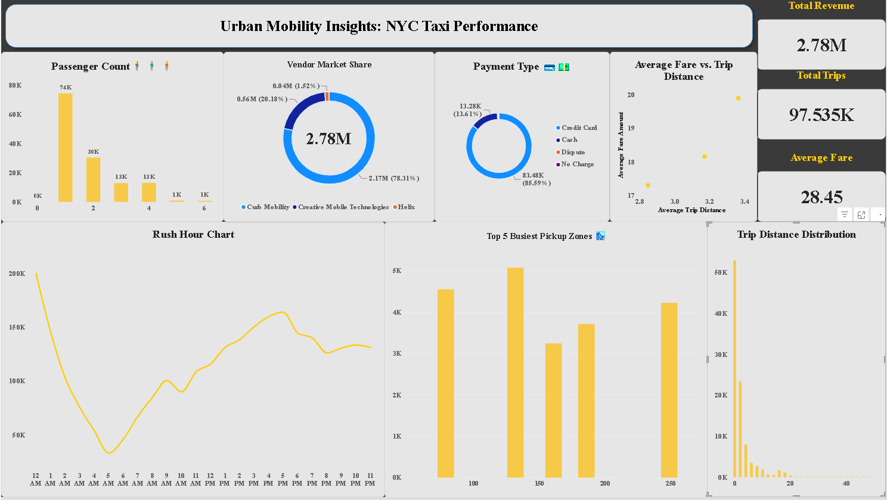

# 🚕 Urban Mobility Insights: NYC Taxi Performance

## 📖 Overview
This project analyzes NYC Yellow Taxi trip records for August 2026. It features an end-to-end data pipeline that extracts raw Parquet data, transforms it into a relational Star Schema, and loads it into a PostgreSQL database for interactive visualization in Power BI.

## 🛠️ Tech Stack
- **Data Extraction & Transformation:** Python, Pandas, Fastparquet
- **Database:** PostgreSQL 17 (Local)
- **Visualization:** Microsoft Power BI
- **Architecture:** Star Schema (Fact & Dimension Tables)

## 📊 Key Business Insights
- **Rush Hour Peaks:** Revenue spikes dramatically during the morning (8 AM - 10 AM) and evening (5 PM - 7 PM) commutes.
- **Short Trips Dominate:** Over 80% of trips are under 5 miles, indicating taxis are primarily used for short, intra-borough travel.
- **Market Share:** Curb Mobility holds the majority market share (78.31%) compared to Creative Mobile Technologies (20.18%).
- **Payment Preferences:** Credit cards are the overwhelming preferred payment method (85.59%).

## ⚙️ Pipeline Architecture
1. **Extract:** Reads raw TLC Trip Records (Parquet) using memory-efficient chunking.
2. **Transform:** Cleans data, handles nulls, and splits into 7 tables:
   - `fact_trips` (97,535 records)
   - `dim_datetime`, `dim_payment_type`, `dim_vendor`, `dim_ratecode`, `dim_pickup_location`, `dim_dropoff_location`
3. **Load:** Pushes data to a local PostgreSQL instance via SQLAlchemy.
4. **Visualize:** Power BI connects directly to the database to render the dashboard.

## 🚀 How to Run
1. Ensure PostgreSQL is running locally on port 5433.
2. Create a database named `DataWareHouse`.
3. Update the connection string in `nyc_taxi_etl.py` with your password.
4. Run `pip install pandas fastparquet sqlalchemy psycopg2-binary`.
5. Execute `python nyc_taxi_etl.py`.

##  Engineering Challenges Overcome
- **Memory Optimization:** Handled large Parquet files on local hardware by utilizing `fastparquet` and strict row-limiting to prevent RAM exhaustion.
- **Environment Debugging:** Navigated complex SQLAlchemy transaction rollbacks and port-mismatch issues between Python and pgAdmin.

## 📸 Dashboard Preview

## 📥 Data Source
Data provided by the [NYC Taxi & Limousine Commission (TLC)](https://www.nyc.gov/site/tlc/about/tlc-trip-record-data.page).